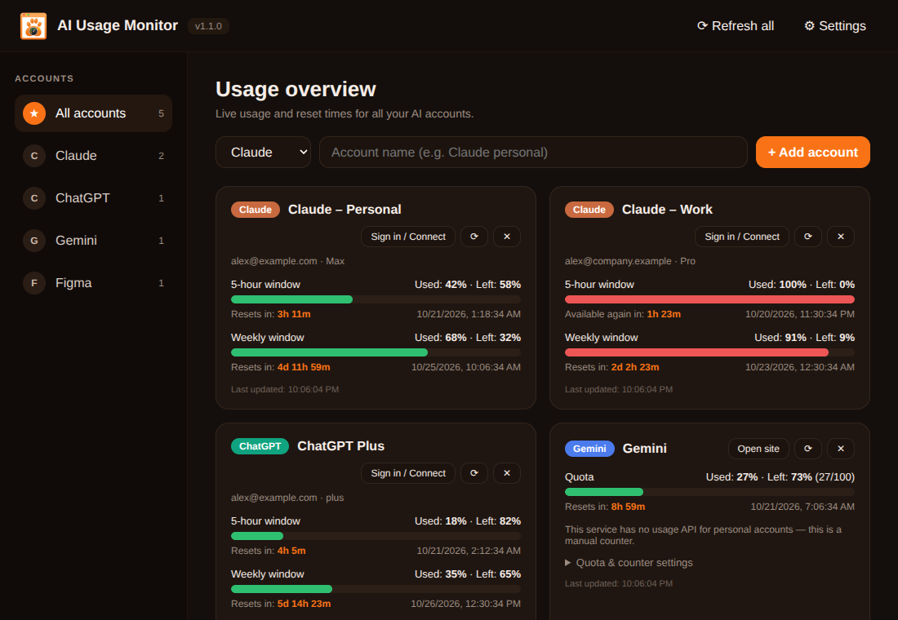
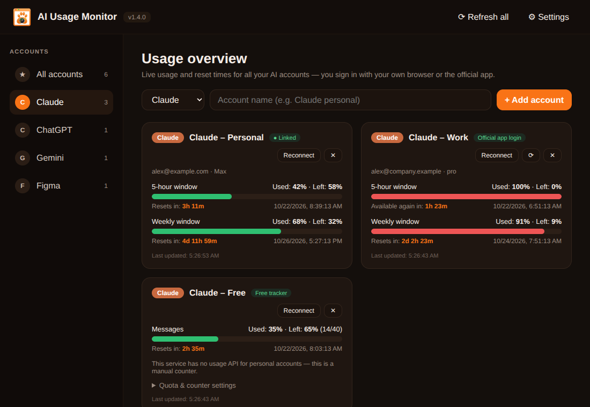
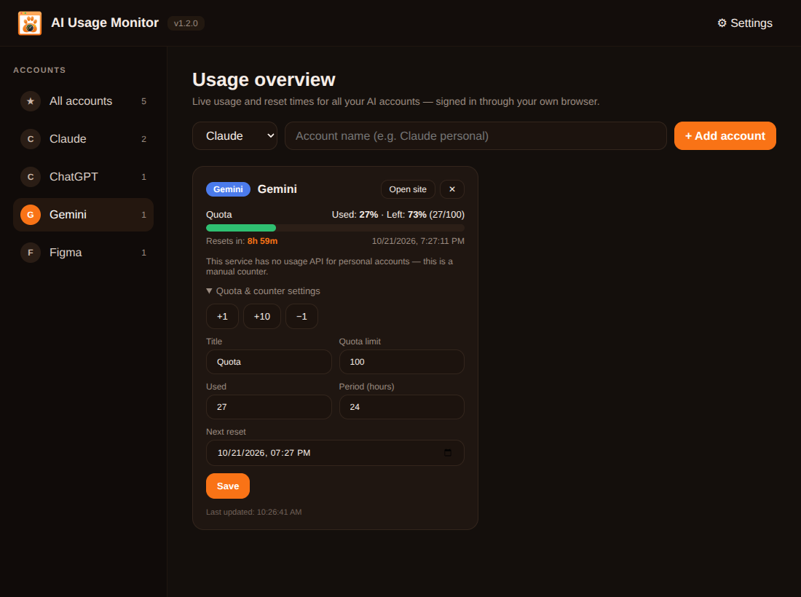
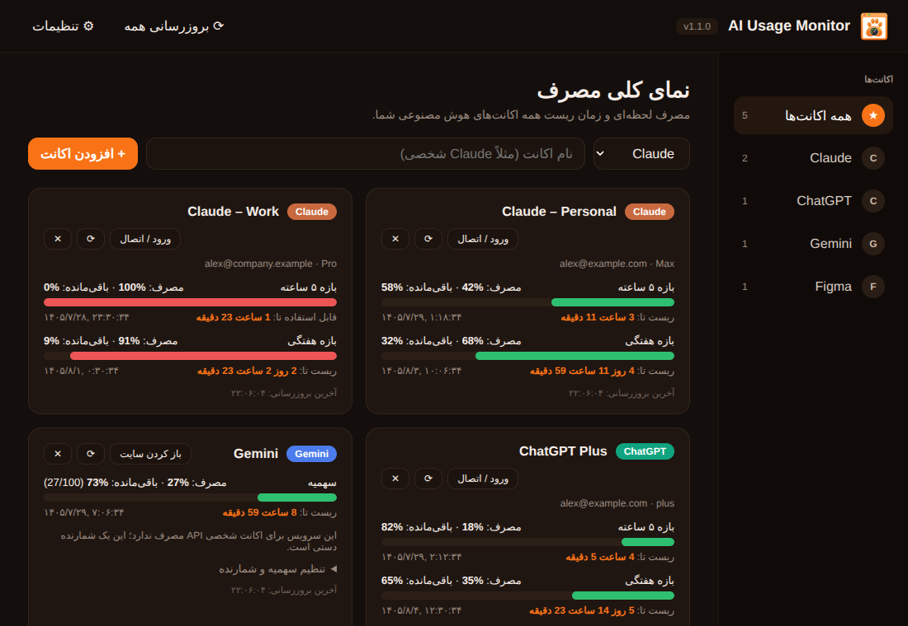
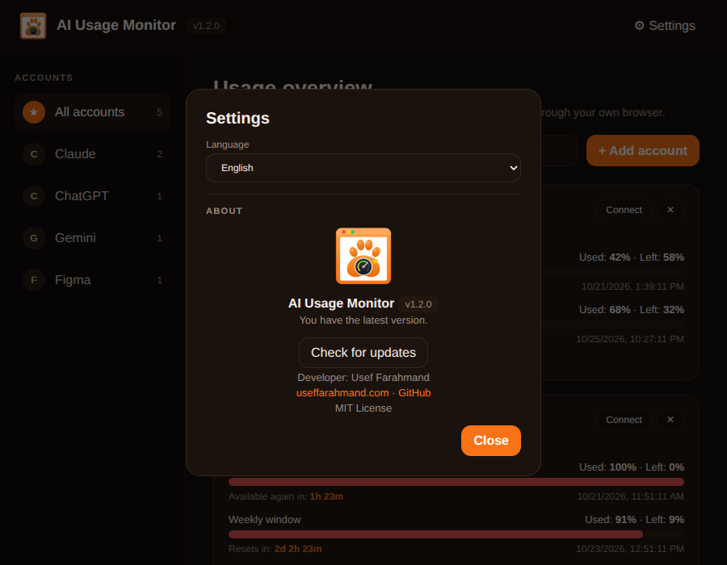

<p align="center"></p>

# AI Usage Monitor

**See how much of your Claude, ChatGPT, Gemini and Figma limits you have left — and exactly when they reset — for every account, in one window.**

[](https://github.com/Jolly-Panda-Works/ai-usage-monitor/actions/workflows/build.yml)
[](https://github.com/Jolly-Panda-Works/ai-usage-monitor/releases/latest)
[](https://github.com/Jolly-Panda-Works/ai-usage-monitor/releases)
[](LICENSE)
[](#download-and-install-windows)

[Download](https://github.com/Jolly-Panda-Works/ai-usage-monitor/releases/latest) · [Report a bug](https://github.com/Jolly-Panda-Works/ai-usage-monitor/issues/new?template=bug_report.yml) · [Request a feature](https://github.com/Jolly-Panda-Works/ai-usage-monitor/issues/new?template=feature_request.yml)



*Screenshots in this README use demo data and may not show the newest screens.*

## Why?
If you use several AI accounts you constantly wonder: *which one still has quota, and when does the other one come back?* AI Usage Monitor answers that at a glance, with live countdowns and a Windows notification when an exhausted account becomes available again.

## Features
- Multiple accounts per service (e.g. several Claude accounts), each with its own isolated sign-in.
- **Sign in inside the app** — no browser extension, nothing to install in your browser. If a site blocks sign-in inside embedded windows (e.g. “Continue with Google”), paste the session cookie instead.
- Used %, remaining % and a live **reset countdown** for every limit window the service reports (5-hour, weekly, …).
- **Free-plan quota tracker** for every service: see used / remaining **tokens** (or messages, credits), the limit you know, and a live **reset countdown** — even when the service shows nothing for Free accounts.
- Windows notification when a limit resets.
- **Automatic updates:** every build gets a higher version number, so each update installs over the previous one — in the app or by running the new installer.
- Dark-and-orange interface, **English and Persian (RTL)**.
- No telemetry; nothing leaves your PC except requests to the services themselves. See [PRIVACY.md](PRIVACY.md).

## Screenshots
| | |
| --- | --- |
|  |  |
| **Overview** — every account, every limit window | **Filter** by service (two Claude accounts) |
|  |  |
| **Quota counter** for Gemini / Figma | **Persian (RTL)** interface |
|  | |
| **Settings, About and updates** | |

## How it works
Each Claude / ChatGPT account gets its own private browser session **inside the app**. You sign in once in the sign-in window; from then on the app reads your usage from that session — the same way the website itself does — and shows it as percentages and countdowns. Your password is never seen or stored by the app; only the session cookies the website sets are kept (like a browser profile), separately for every account.

## Connect an account
1. Press **Add account**, choose **Claude** or **ChatGPT**, give it a name and press **Add account**. A sign-in window opens.
2. Sign in there (e-mail code / password). Close the window — the card fills in within seconds. Press **Sign in** on a card any time to open the window again.
3. **Google sign-in blocked?** Some sites refuse Google sign-in inside embedded windows. Press **Can’t sign in (e.g. Google)? Use a cookie** on the card, sign in in your normal browser, copy the session cookie (`sessionKey` for Claude, `__Secure-next-auth.session-token` for ChatGPT; DevTools → Application → Cookies) and paste it. It is stored only inside the app, for that account.

**Gemini and Figma** have no usage API for personal accounts, so they use the quota tracker below; the *Open site* button opens the site in your browser.

## Free accounts: tokens and reset time
Free plans usually don’t publish exact numbers, and the websites often return no usage meters for them (the card then says so). For those accounts, turn on the **Free quota tracker** (it is on by default for Gemini and Figma, one click for Claude and ChatGPT):

- Pick the **unit** — tokens, messages, credits — and enter the **limit** you know (leave `0` if you don’t know it).
- Add what you use with the quick buttons (`+1K`, `+10K`, `+100K` tokens …) or type the exact number.
- **Session** windows (Claude and ChatGPT Free: a limit that resets a few hours after you start using it — 5 hours by default) start automatically with your first usage, or press **Start window now**. **Fixed** windows (daily / monthly quotas) repeat on a schedule.
- You see *used*, *left*, the percentage and a live **“resets in …”** countdown, plus a Windows notification when a used-up quota resets.

The tracker is a counter **you** keep — the services don’t report these numbers for Free accounts, so the app can’t read them automatically.

## Supported services
| Service | How usage is read | Notes |
| --- | --- | --- |
| **Claude** | Sign-in session inside the app | 5-hour and weekly windows when the plan reports them; Free accounts → quota tracker |
| **ChatGPT** | Sign-in session inside the app | Windows depend on your plan; Free accounts → quota tracker |
| **Gemini** | Quota tracker | No public usage API for personal accounts |
| **Figma** | Quota tracker | No public usage API for personal accounts |

> Claude and ChatGPT use **undocumented** website endpoints. They can change without notice; if one breaks, please [open an issue](https://github.com/Jolly-Panda-Works/ai-usage-monitor/issues/new?template=bug_report.yml). Results are percentages as reported by the service, not raw token counts.

## Download and install (Windows)
1. Open the [**Releases**](https://github.com/Jolly-Panda-Works/ai-usage-monitor/releases/latest) page.
2. Download `AI-Usage-Monitor-Setup-<version>.exe` (installer, **recommended**) or `AI-Usage-Monitor-Portable-<version>.exe` (no install, no auto-update).
3. Run it, then follow [Connect an account](#connect-an-account).

**Updating.** The installer version updates itself: the app checks GitHub Releases at start and every 6 hours, downloads new versions in the background and installs them when you quit (or press **Restart and update** in *Settings → About*). You can also simply run a newer installer — it installs over the old one and keeps your accounts and settings.

> **SmartScreen warning?** The app is not code-signed yet. Click **More info → Run anyway**. Verify downloads with `SHA256SUMS.txt` — see [CODE_SIGNING.md](CODE_SIGNING.md).

## Run from source
Requirements: **Node.js 20+**.
```
git clone https://github.com/Jolly-Panda-Works/ai-usage-monitor.git
cd ai-usage-monitor
npm install
npm start
```

## Build and release (GitHub Actions)
Every push to `main` builds the app on `windows-latest`, sets the version automatically and publishes a GitHub Release with the installer, the portable `.exe`, the update metadata (`latest.yml`) and `SHA256SUMS.txt`. Documentation-only pushes (`*.md`, `docs/`) don't trigger a build. Releases do not use Actions artifact storage.

**Versioning.** `MAJOR.MINOR.<build number>` — `MAJOR.MINOR` come from `package.json` (change them there to start a new line, e.g. `1.3.0`); the build number is added by CI and only ever increases, which is what lets every update install over the previous one. The version shows in the app header and *Settings → About*. Pushing a tag `vX.Y.Z` publishes exactly that version (it must be higher than the latest one). Build locally with `npm install && npm run dist` → files appear in `dist/`.

## Project structure
```
ai-usage-monitor/
├── src/
│   ├── main.js          # Electron main process: windows, sessions, updater
│   ├── preload.js       # safe bridge to the UI
│   ├── providers.js     # service fetchers + Free quota tracker
│   ├── renderer.js      # UI logic + English/Persian strings
│   ├── index.html  styles.css
├── assets/              # logo.svg / logo.png / icon.ico
├── docs/                # README screenshots (demo data)
├── tools/set-version.js # CI: decides the build version
├── .github/             # build/release + CI workflows, issue & PR templates, Dependabot
├── CHANGELOG.md  CONTRIBUTING.md  CODE_OF_CONDUCT.md
├── SECURITY.md  PRIVACY.md  CODE_SIGNING.md  LICENSE
└── package.json
```

## Limitations
- Unofficial endpoints (Claude, ChatGPT) may break when the websites change.
- Free accounts: the services don’t report tokens/messages left, so those numbers come from the tracker you keep.
- Google / SSO sign-in may be blocked inside the sign-in window — use the cookie option.
- Windows only for packaged builds; no code signing yet.

## Troubleshooting
| Problem | Fix |
| --- | --- |
| “Connected, but … returned no usage meters” | Usually a Free account: the service has no percentage meters for it. Turn on the **Free quota tracker** on the card. |
| “Not signed in” | Press **Sign in** and log in inside the window (or use the cookie option). |
| “Cloudflare asked for a check” | Press **Sign in** and complete the check in the window, then close it. |
| Cookie accepted but still “Not signed in” | The cookie expired or was copied from another account — copy it again, or use the sign-in window. |
| ChatGPT shows “no usage data for this plan” | Your plan may not expose usage; use the tracker, or open an issue with your plan type. |
| “Windows protected your PC” | **More info → Run anyway**; see [CODE_SIGNING.md](CODE_SIGNING.md). |

## Contributing
Contributions are welcome — read [CONTRIBUTING.md](CONTRIBUTING.md) and the [Code of Conduct](CODE_OF_CONDUCT.md). Vulnerabilities: see [SECURITY.md](SECURITY.md).

## Responsible use
Use the app only with your own accounts and respect each service's terms of use. The app is not affiliated with Anthropic, OpenAI, Google or Figma. The authors are not responsible for misuse.

## License
Released under the [MIT License](LICENSE) © 2026 [Usef Farahmand](https://useffarahmand.com) · Jolly Panda Studio.

## Acknowledgments
[Electron](https://www.electronjs.org/) · [electron-builder](https://www.electron.build/) · [electron-updater](https://www.electron.build/auto-update)
