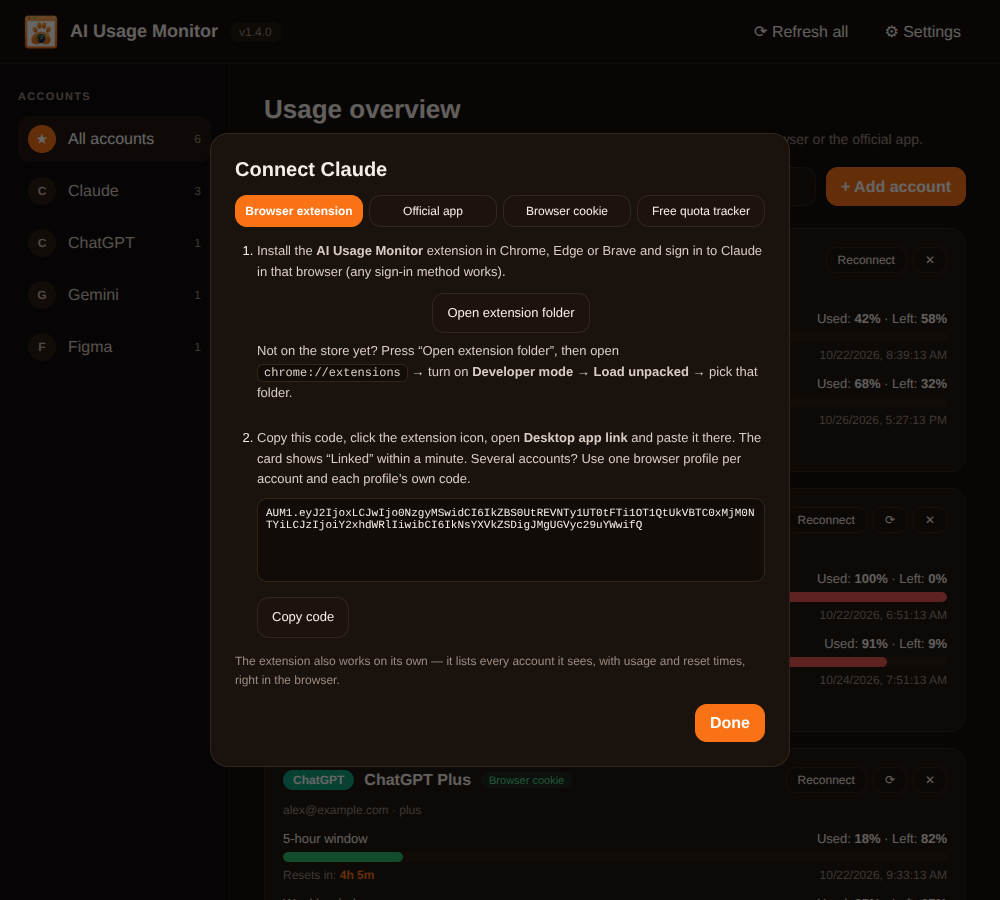
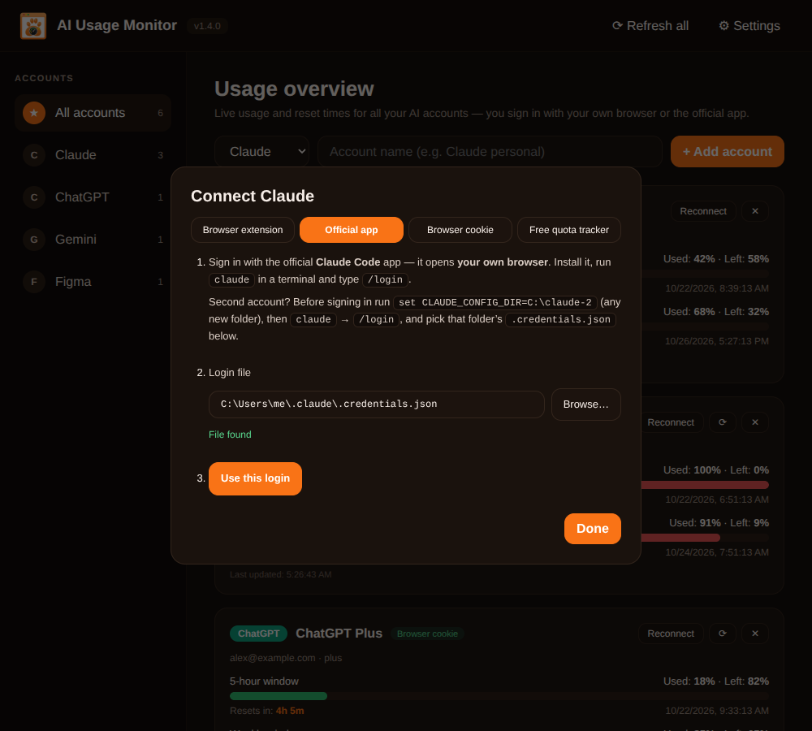
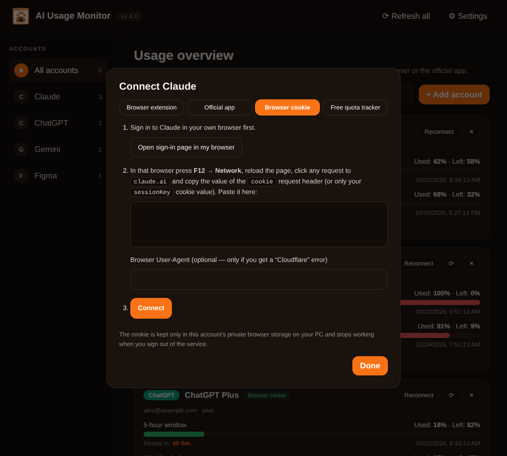
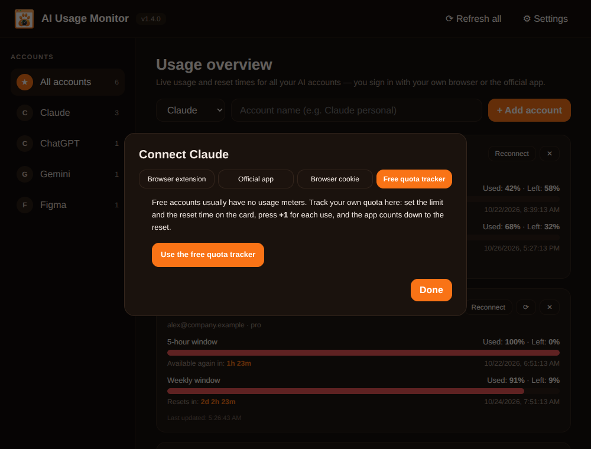
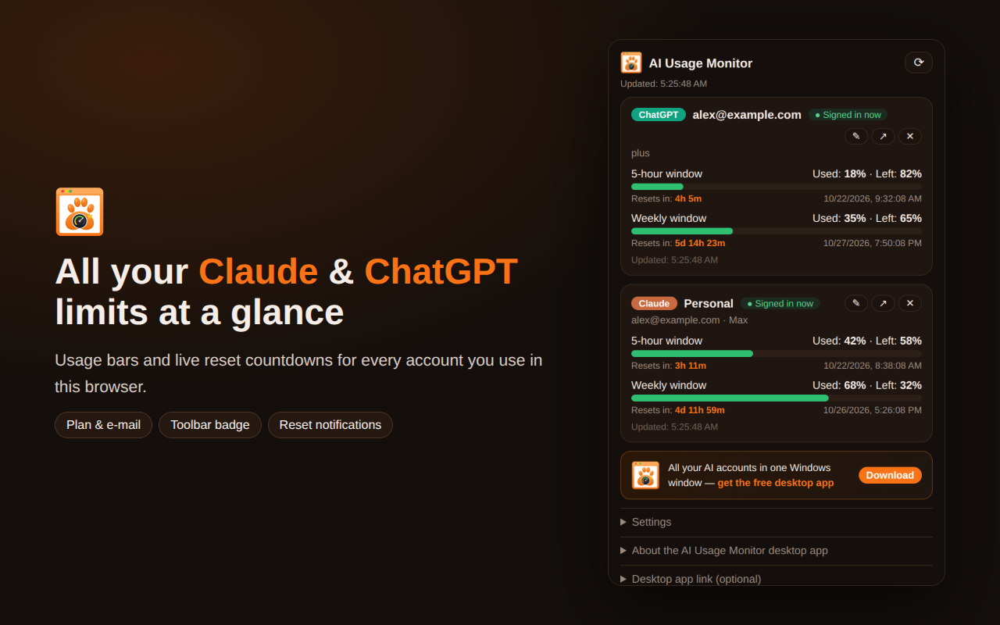
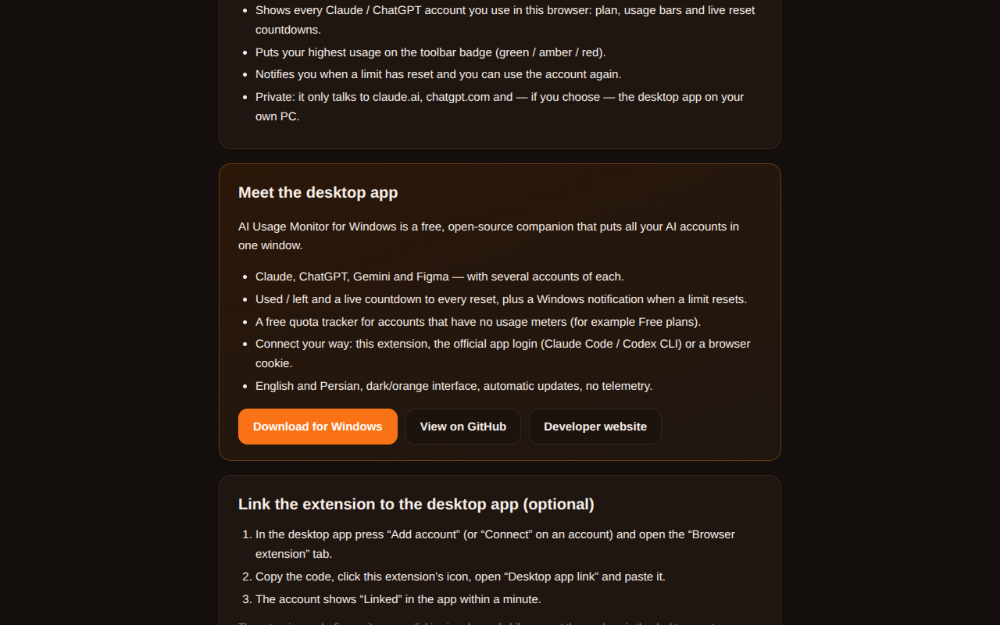

<p align="center"></p>

# AI Usage Monitor

**See how much of your Claude, ChatGPT, Gemini and Figma limits you have left — and exactly when they reset — for every account, in one window. Plus a browser extension that shows the same right in Chrome.**

[](https://github.com/Jolly-Panda-Works/ai-usage-monitor/actions/workflows/build.yml)
[](https://github.com/Jolly-Panda-Works/ai-usage-monitor/releases/latest)
[](https://github.com/Jolly-Panda-Works/ai-usage-monitor/releases)
[](LICENSE)
[](#download-and-install-windows)

[Download](https://github.com/Jolly-Panda-Works/ai-usage-monitor/releases/latest) · [Report a bug](https://github.com/Jolly-Panda-Works/ai-usage-monitor/issues/new?template=bug_report.yml) · [Request a feature](https://github.com/Jolly-Panda-Works/ai-usage-monitor/issues/new?template=feature_request.yml)


*Screenshots in this README use demo data.*

## Why?
If you use several AI accounts you constantly wonder: *which one still has quota, and when does the other one come back?* AI Usage Monitor answers that at a glance, with live countdowns and a notification when an exhausted account becomes available again.

## What's in this repo
| Part | What it is |
| --- | --- |
| **Desktop app** (`src/`) | Windows app: all accounts in one window, notifications, free quota tracker, automatic updates. |
| **Browser extension** (`extension/`) | Chrome / Edge / Brave extension: shows your Claude and ChatGPT accounts, usage and resets in the browser — works on its own and can optionally report to the desktop app. |

## Features
- Multiple accounts per service (e.g. several Claude accounts).
- **You never sign in inside the app.** Four ways to connect: the browser extension, the official app login (Claude Code / Codex CLI), a pasted browser cookie, or a free quota tracker.
- Used %, remaining % and a live **reset countdown** for every limit window (5-hour, weekly, …).
- Notification when a limit resets (Windows app and browser).
- **Automatic updates:** every build gets a higher version number, so each update installs over the previous one — in the app or by running the new installer.
- Dark-and-orange interface, **English and Persian (RTL)**.
- No telemetry; nothing leaves your PC. See [PRIVACY.md](PRIVACY.md).

## Screenshots
| | |
| --- | --- |
|  |  |
| **Overview** — every account, every limit window | **Connect** — browser extension |
|  |  |
| **Connect** — official app login | **Connect** — browser cookie |
|  |  |
| **Free quota tracker** for accounts without usage meters | **Counter** card with +1 / limit / reset |
|  |  |
| **Persian (RTL)** interface | **Settings, About and updates** |

### Browser extension
| | |
| --- | --- |
|  |  |
| **Popup** — accounts, usage bars, resets | **Welcome page** — introduces the extension and the desktop app |

## How it works
Claude and ChatGPT have no public usage API for personal accounts. AI Usage Monitor therefore reads the same usage data their own pages show, using a login **you** created in your own browser or in the official command-line app. The Windows app polls (default every 5 minutes) or receives reports from the extension (every minute) and shows everything in one window.

## Connect an account
Press **Add account**, pick the service, name it — the *Connect* dialog opens with four tabs:

**1. Browser extension.** Install the extension (Chrome / Edge / Brave), sign in to the service in that browser the way you always do, copy the code from the app and paste it in the extension's *Desktop app link*. The card shows **Linked** within a minute. The extension also works **without** the app — it lists every account it sees. Several accounts of one service? Use one browser profile per account and each profile's own code. Install: *Chrome Web Store* (once published) or *Open extension folder* → `chrome://extensions` → **Developer mode** → **Load unpacked**.

**2. Official app login.** Install the official command-line app and sign in — it opens *your own browser*: Claude → **Claude Code** (`claude`, then `/login`); ChatGPT → **Codex CLI** (`codex login`). The login file is detected automatically (`%USERPROFILE%\.claude\.credentials.json` / `%USERPROFILE%\.codex\auth.json`); press **Use this login**. **Second account?** Give the official app a separate config folder first — `set CLAUDE_CONFIG_DIR=C:\claude-2` or `set CODEX_HOME=C:\codex-2` — sign in again and use **Browse…**. The app only reads the token; it never changes the file. If the token expires, use Claude Code / Codex once or reconnect.

**3. Browser cookie.** Sign in on the website, press **F12 → Network**, reload, click any request to the site and copy the `cookie` request header value into the dialog. It stays in that account's private storage on your PC. If you get a *Cloudflare* error, also paste your browser's `User-Agent`.

**4. Free quota tracker.** Free accounts usually have no usage meters. Set the limit and reset time on the card and press **+1** per use; the app counts down to the reset. **Gemini and Figma** always use this counter (no public usage API); **Open site** opens the website in your browser.

**“No usage data came back”?** The service answered without limit fields the app recognises — typical for **Free** accounts (use the free quota tracker) or when an unofficial endpoint changed. For the official-app and cookie methods open **Diagnostics** on the card (request log + response *structure*, no values) and copy it into an issue.

## Supported services
| Service | Ways to connect | Notes |
| --- | --- | --- |
| **Claude** | Extension · Claude Code login · cookie · free tracker | 5-hour and weekly windows; several accounts |
| **ChatGPT** | Extension · Codex CLI login · cookie · free tracker | Windows depend on your plan |
| **Gemini** | Counter | No public usage API for personal accounts |
| **Figma** | Counter | No public usage API for personal accounts |

> Claude and ChatGPT use **undocumented** website endpoints. They can change without notice; if one breaks, please [open an issue](https://github.com/Jolly-Panda-Works/ai-usage-monitor/issues/new?template=bug_report.yml). Results are percentages as reported by the service, not raw token counts.

## Download and install (Windows)
1. Open the [**Releases**](https://github.com/Jolly-Panda-Works/ai-usage-monitor/releases/latest) page.
2. Download `AI-Usage-Monitor-Setup-<version>.exe` (installer, **recommended**) or `AI-Usage-Monitor-Portable-<version>.exe` (no install, no auto-update).
3. Run it, then follow [Connect an account](#connect-an-account).

**Updating.** The installer version updates itself: it checks GitHub Releases at start and every 6 hours, downloads new versions in the background and installs them when you quit (or press **Restart and update** in *Settings → About*). You can also simply run a newer installer — it installs over the old one and keeps your accounts and settings.

> **SmartScreen warning?** The app is not code-signed yet. Click **More info → Run anyway**. Verify downloads with `SHA256SUMS.txt` — see [CODE_SIGNING.md](CODE_SIGNING.md).

## Install the browser extension
- **From the Chrome Web Store** — once published (see [docs/PUBLISH_EXTENSION.md](docs/PUBLISH_EXTENSION.md) for how to publish it).
- **Manually** — in the desktop app: *Connect → Browser extension → Open extension folder*, or unzip `AI-Usage-Monitor-Extension-<version>.zip` from the release; then `chrome://extensions` → **Developer mode** → **Load unpacked**.
- After updating the desktop app, press the reload icon on the extension card if the extension changed.

## Run from source
Requirements: **Node.js 20+**.
```
git clone https://github.com/Jolly-Panda-Works/ai-usage-monitor.git
cd ai-usage-monitor
npm install
npm start
```

## Build and release (GitHub Actions)
Every push to `main` builds the app on `windows-latest`, sets the version automatically and publishes a GitHub Release with the installer, the portable `.exe`, the update metadata (`latest.yml`), the extension zip and `SHA256SUMS.txt`. Documentation-only pushes (`*.md`, `docs/`, `store/`) don't trigger a build. Releases do not use Actions artifact storage.

**Versioning.** The app version is `MAJOR.MINOR.<build number>` — `MAJOR.MINOR` come from `package.json` (change them there to start a new line); the build number is added by CI and only ever increases, which is what lets every update install over the previous one. Pushing a tag `vX.Y.Z` publishes exactly that version (it must be higher than the latest one). **The extension has its own version** (`extension/manifest.json`): raise it by hand before each Chrome Web Store upload. Build locally with `npm install && npm run dist` → files appear in `dist/`.

## Project structure
```
ai-usage-monitor/
├── src/
│   ├── main.js          # Electron main process: windows, accounts, refresh timer, updater
│   ├── bridge.js        # 127.0.0.1 receiver for the extension (token-protected)
│   ├── fetchers.js      # official-app / cookie usage fetchers (generic parsing + diagnostics)
│   ├── providers.js     # service metadata + manual counters
│   ├── preload.js  renderer.js  index.html  styles.css
├── extension/           # Chromium extension (popup dashboard, welcome page, optional desktop link)
├── store/               # Chrome Web Store assets and ready-to-paste listing texts
├── assets/              # logo.svg / logo.png / icon.ico
├── docs/                # README screenshots, extension publishing guide (EN / FA)
├── tools/set-version.js # CI: decides the app build version
├── .github/             # build/release + CI workflows, issue & PR templates, Dependabot
├── CHANGELOG.md  CONTRIBUTING.md  CODE_OF_CONDUCT.md
├── SECURITY.md  PRIVACY.md  CODE_SIGNING.md  LICENSE
└── package.json
```

## Limitations
- Unofficial endpoints (Claude, ChatGPT) may break when the websites change.
- The browser must be running for the extension to report; the official-app login must be refreshed by that app now and then; cookies stop working when you sign out.
- Gemini, Figma and Free accounts need manual counting.
- Windows only for packaged desktop builds; no code signing yet.

## Troubleshooting
| Problem | Fix |
| --- | --- |
| Card says "Waiting for the browser…" | The browser is closed, the extension isn't linked, or the code was pasted for another account. Open the extension popup → *Desktop app link* shows the last status. |
| Extension says "Desktop app is not running" | Start AI Usage Monitor; keep only one copy running (it uses local ports 47821–47825). |
| "Not signed in" in the extension | Sign in to the service in that browser (profile); it updates within a minute. |
| "The saved app login has expired" | Use Claude Code / Codex once so it refreshes its token, or press **Reconnect**. |
| "Blocked by Cloudflare" | Use the extension or the official app login, or reconnect with the full `cookie` header **and** your browser's `User-Agent`. |
| "No usage meters came back" | Usually a Free account → *Free quota tracker*. Otherwise copy **Diagnostics** into an issue. |
| "Windows protected your PC" | **More info → Run anyway**; see [CODE_SIGNING.md](CODE_SIGNING.md). |

## Contributing
Contributions are welcome — read [CONTRIBUTING.md](CONTRIBUTING.md) and the [Code of Conduct](CODE_OF_CONDUCT.md). Vulnerabilities: see [SECURITY.md](SECURITY.md).

## Responsible use
Use the app only with your own accounts and respect each service's terms of use. The app is not affiliated with Anthropic, OpenAI, Google or Figma. The authors are not responsible for misuse.

## License
Released under the [MIT License](LICENSE) © 2026 [Usef Farahmand](https://useffarahmand.com) · Jolly Panda Studio.

## Acknowledgments
[Electron](https://www.electronjs.org/) · [electron-builder](https://www.electron.build/) · [electron-updater](https://www.electron.build/auto-update)
